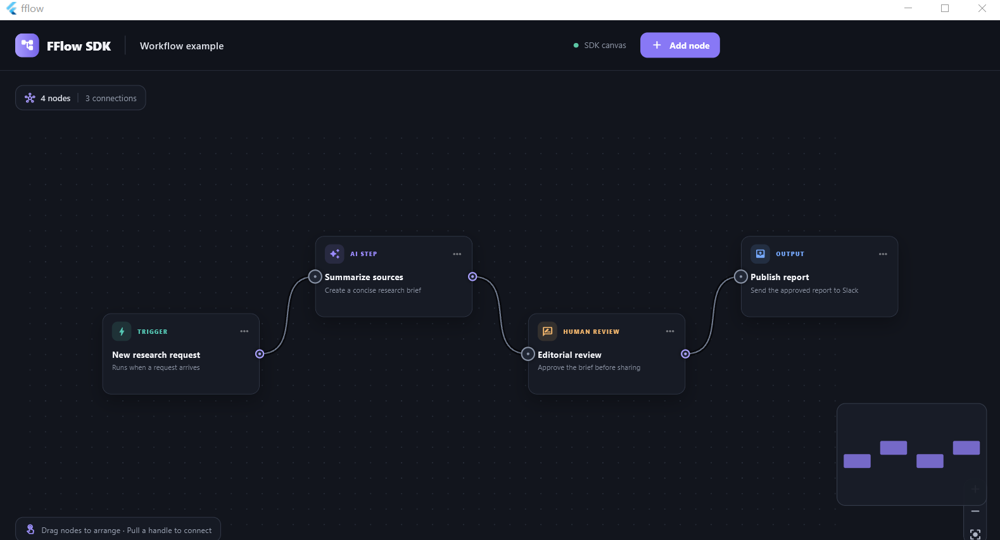

# FFlow

FFlow is a reusable Flutter SDK for building interactive node and edge editors. The root package contains the public API and canvas implementation. The runnable workflow editor is an example app under [`example/`](example/).



## Add FFlow to an app

For local development, add the package to your app's `pubspec.yaml`:

```yaml
dependencies:
  fflow:
    path: ../FFlow
```

Then import the public library:

```dart
import 'package:fflow/fflow.dart';
```

Create typed node data in your application and provide a builder for each node:

```dart
FFlowCanvas<MyNodeData>(
  nodes: nodes,
  edges: edges,
  nodeBuilder: (context, node, selected) => MyNodeCard(
    data: node.data,
    selected: selected,
  ),
  onNodesChanged: (updated) => setState(() => nodes = updated),
  onEdgesChanged: (updated) => setState(() => edges = updated),
);
```

Node and edge lists are controlled by the host app. FFlow reports changes through callbacks; the host app stores the updated lists and rebuilds the canvas. The canvas provides panning, zooming, node dragging, connection handles, connection previews, and customizable node widgets.

## Included editor features

- Drag and resize nodes, snap to an optional grid, select multiple nodes and edges, shift-drag a selection box, and use Delete/Backspace, Ctrl/Cmd+A, or Escape.
- Connect named handles with max-connection and custom validation; select and reconnect edges.
- Choose bezier, straight, step, and smooth-step edges; add labels, markers, animation, or custom edge renderers.
- Control pan/zoom, scroll zoom, double-click zoom, and fit-to-view with `FlowCanvasController`; compose `FFlowControls` and `FFlowMiniMap`.
- Use `FlowGraphUtils` for graph edits and `FlowGraphSnapshot` to save/restore typed graph data.

The package has no third-party dependencies. React Flow's React hooks, DOM/CSS behavior, and React-specific integrations do not map directly to Flutter; FFlow exposes equivalent graph concepts through Flutter widgets and Dart APIs.

## Supported platform status

The SDK canvas and graph logic use Flutter/Dart and are shared across targets. Platform runner projects belong to the demo app under `example/`; FFlow itself does not add platform-specific native plugins.

| Target | Implementation | Build/validation status |
| --- | --- | --- |
| Windows | Flutter Windows runner in `example/windows/`; uses the shared FFlow canvas. | The demo's Windows release build has succeeded on a Windows host. |
| Linux | Flutter Linux runner in `example/linux/`; uses the shared FFlow canvas. | Runner is included, but a Linux build has not been verified. UOS compatibility is also unverified; check the release bundle's system-library requirements on the target distribution. |
| macOS | Flutter macOS runner in `example/macos/`; uses the shared FFlow canvas. | Runner is included, but a macOS build has not been verified. |
| Web | Flutter web runner in `example/web/`; uses the shared FFlow canvas. | Runner is included, but a browser build has not been verified. |
| Android / iOS | Not in scope; the demo has no mobile runners. | Not supported by this project. |

Flutter desktop builds require the platform's development toolchain. Linux release bundles can also depend on system libraries provided by the target distribution, so test Linux packages on each distribution you plan to support.

## FFlow and React Flow feature comparison

This compares FFlow's implemented SDK APIs with React Flow's documented core features. It is a feature-clone subset, not a React API or ecosystem clone.

| Area | FFlow | Compared with React Flow |
| --- | --- | --- |
| Graph state | Controlled `nodes` and `edges`, change callbacks, immutable list helpers, and typed graph snapshots. | Same controlled-graph model; React Flow additionally exposes React hooks and a flow instance/store API. |
| Nodes and selection | Custom Flutter node widgets, dragging, optional resizing, single/multi-select, Shift box selection, group dragging, and Delete/Backspace, Ctrl/Cmd+A, and Escape shortcuts. | Covers the common editing loop. React Flow has more interaction options and richer keyboard accessibility, including focus navigation and arrow-key node movement. |
| Connections | Named source/target handles, connection preview, capacity and duplicate checks, custom validation, and edge reconnection. | Core connection concepts are covered; React Flow offers additional connection and handle configuration. |
| Edges | Bezier, straight, step, smooth-step, and simple-bezier paths; labels, arrow markers, animation, selection, hit testing, reconnection, and custom edge builders. | Core edge types are covered. React Flow also has dedicated edge labels/toolbars and a larger SVG customization surface; FFlow renders through Flutter painters/widgets. |
| Viewport and canvas chrome | Pan/zoom controller, scroll and double-click zoom, fit-to-view, controls, interactive minimap, and dot/line/cross backgrounds. | Covers the main viewport workflow. React Flow has more built-in overlay components and control options; Flutter apps can compose additional overlays with normal widgets. |
| Subflows | Parent-relative positions and dragging a parent with its descendants. | Partial: FFlow does not currently constrain children to parent bounds or automatically resize parents. React Flow supports parent extents and parent expansion options. |
| Accessibility and integrations | Basic editor shortcuts; custom UI is built with Flutter widgets and Dart. | FFlow does not yet provide React Flow's full focus/ARIA keyboard-navigation behavior, React hooks/store, DOM/CSS integration, or first-party extension ecosystem. |

In short, FFlow implements the main graph editing experience—custom nodes, connections, selection, edge rendering, and viewport navigation. The largest gaps are advanced interaction configuration, complete keyboard/screen-reader accessibility, parent-bound behavior, and React Flow's broader component/API ecosystem.

References: [React Flow interactivity](https://reactflow.dev/learn/concepts/adding-interactivity), [hooks](https://reactflow.dev/api-reference/hooks), [built-in components](https://reactflow.dev/api-reference/components), [sub flows](https://reactflow.dev/learn/layouting/sub-flows), [accessibility](https://reactflow.dev/learn/advanced-use/accessibility), [Flutter desktop support](https://docs.flutter.dev/platform-integration/desktop), and [Flutter Linux builds](https://docs.flutter.dev/platform-integration/linux/building).

## Versioning and releases

The SDK version is defined by `version` in the repository-root `pubspec.yaml`. The example app has its own version in `example/pubspec.yaml`; it consumes FFlow through a local path dependency, so its version does not need to match the SDK.

FFlow currently uses `0.x` versions while its public API is still developing. Record unreleased changes under `Unreleased` in [`CHANGELOG.md`](CHANGELOG.md). When cutting a release, move those notes to a version heading and update the root package version. After `1.0.0`, use Semantic Versioning: patch for compatible fixes, minor for backward-compatible features, and major for breaking API changes. Call out breaking changes explicitly in the changelog.

Release checklist:

1. Update `CHANGELOG.md` and the root `pubspec.yaml` version to the same `x.y.z` version.
2. Run `flutter analyze`, the available tests, and release builds for the supported targets. Run `flutter pub publish --dry-run` when preparing a pub.dev release.
3. Commit the release metadata, for example `chore(release): 0.1.0`.
4. Create and push an annotated Git tag that matches the package version with a `v` prefix:

   ```powershell
   git tag -a v0.1.0 -m "FFlow 0.1.0"
   git push origin master
   git push origin v0.1.0
   ```

5. Create a GitHub Release from that tag. Publish to pub.dev separately only when that distribution channel is intended.

Do not reuse a version after publishing it. The SDK package does not commit a root `pubspec.lock`; the runnable example is an app and keeps `example/pubspec.lock` under version control.

Once a release tag exists, apps that consume FFlow directly from GitHub can pin that tag instead of using a local path. Replace the sample tag with the version being consumed:

```yaml
dependencies:
  fflow:
    git:
      url: https://github.com/risol/FFlow.git
      ref: v0.1.0
```

Dart references: [pubspec version rules](https://dart.dev/tools/pub/pubspec) and [package layout, changelog, and lockfile conventions](https://dart.dev/tools/pub/package-layout).

## SDK entry points

```dart
final controller = FlowCanvasController();

Stack(
  children: [
    FFlowCanvas<MyNodeData>(
      controller: controller,
      nodes: nodes,
      edges: edges,
      nodeBuilder: (context, node, selected) =>
          MyNodeCard(data: node.data, selected: selected),
      onNodesChanged: (value) => setState(() => nodes = value),
      onEdgesChanged: (value) => setState(() => edges = value),
      onConnect: (connection) {
        final edge = FlowGraphInteraction.createEdge(connection, createId());
        if (edge != null) {
          setState(() => edges = FlowGraphUtils.addEdge(edges, edge));
        }
      },
    ),
    FFlowControls(
      controller: controller,
      nodes: nodes,
      viewportSize: canvasSize,
    ),
  ],
)
```

## Run the example

Run the example on one of the supported targets from the repository root:

```powershell
cd example
flutter pub get
flutter run -d windows
```

The example includes platform runners for Windows, Linux, macOS, and Web. Android and iOS are outside this project's target scope. The SDK itself does not include an application entry point or platform runner.

## Package layout

```text
lib/
  fflow.dart                 Public package API
  src/
    canvas/                  Reusable graph canvas and event orchestration
    controllers/             Viewport controller
    geometry/                Handle and edge geometry
    interactions/            Connection and graph interaction logic
    models/                  Node, edge, handle, selection, snapshot models
    rendering/               Grid, edges, and handles
    utils/                   Immutable graph editing helpers
    widgets/                 Controls and minimap
example/
  lib/                       Runnable demonstration app
  windows/, linux/, macos/, web/  Supported example app platform runners
```
