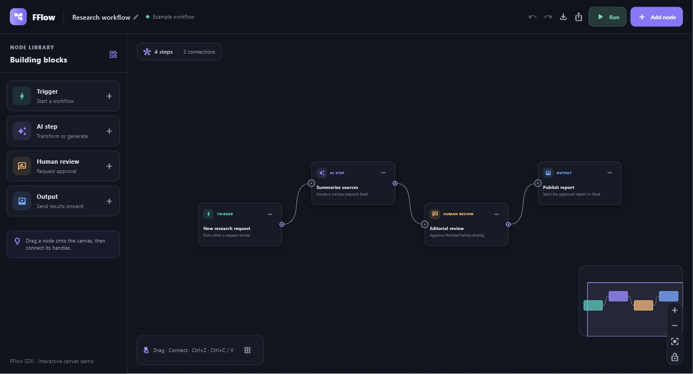

# FFlow

FFlow is a Flutter SDK for building interactive, node-based editors. Use it to create workflow builders, visual automation tools, data pipelines, state machines, and other graph interfaces that fit the rest of your Flutter app.

The SDK provides the graph canvas, node and edge models, editing interactions, viewport navigation, and reusable controls. Your app defines the node data and UI, applies domain-specific validation, and decides what running a workflow means. Keep graph state in your own widgets with change callbacks, or use `FlowGraphController` when you want observable graph state and indexed queries. FFlow is Flutter-native and has no third-party runtime dependencies.

This repository contains the SDK package at its root and a runnable workflow editor in [`example/`](example/). The example demonstrates a four-step research workflow, with a node library, draggable canvas, connectable handles, overview minimap, and editor actions.



*The example editor shows a trigger, AI step, human review, and output connected on a navigable canvas.*

## How FFlow fits into an app

FFlow handles the graph-editing surface while your app owns the meaning of the graph. A typical integration defines typed data for each node, maps that data to custom Flutter widgets, and then updates graph state in response to canvas changes. You can keep state in your widget tree with controlled `nodes` and `edges`, or move it into `FlowGraphController`. Add history, clipboard, snapshots, layouts, or routing as your editor needs them.

## Add FFlow to an app

For local development, add the package to your app's `pubspec.yaml`:

```yaml
dependencies:
  fflow:
    path: ../FFlow
```

Then import the public library:

```dart
import 'package:fflow/fflow.dart';
```

Create typed node data in your application and provide a builder for each node. The canvas reports graph changes through callbacks, so the host app remains responsible for storing the updated state:

```dart
FFlowCanvas<MyNodeData>(
  nodes: nodes,
  edges: edges,
  nodeBuilder: (context, node, selected) => MyNodeCard(
    data: node.data,
    selected: selected,
  ),
  onNodesChanged: (updated) => setState(() => nodes = updated),
  onEdgesChanged: (updated) => setState(() => edges = updated),
);
```

By default, node and edge lists are controlled by the host app. FFlow reports changes through callbacks; the host stores the updated lists and rebuilds the canvas. Apps can instead pass a `FlowGraphController` to own observable graph state and query it without wiring list callbacks themselves.

For typed, fine-grained updates, use `onNodesChange` and `onEdgesChange`. Each callback receives a batch of `FlowNodeChange` or `FlowEdgeChange` values, which can be applied with `FlowGraphUtils`. These callbacks run before the compatibility list callbacks (`onNodesChanged` and `onEdgesChanged`); use one callback style to update controlled state.

```dart
FFlowCanvas<MyNodeData>(
  nodes: nodes,
  edges: edges,
  nodeBuilder: (context, node, selected) => MyNodeCard(
    data: node.data,
    selected: selected,
  ),
  onNodesChange: (changes) => setState(() {
    nodes = FlowGraphUtils.applyNodeChanges(changes, nodes);
  }),
  onEdgesChange: (changes) => setState(() {
    edges = FlowGraphUtils.applyEdgeChanges(changes, edges);
  }),
);
```

```dart
final graph = FlowGraphController<MyNodeData>(nodes: nodes, edges: edges);

FFlowCanvas<MyNodeData>(
  graphController: graph,
  nodeBuilder: (context, node, selected) => MyNodeCard(
    data: node.data,
    selected: selected,
  ),
);

final incoming = graph.getIncomers('review');
final bounds = graph.nodesBounds;
```

## Included editor features

- Drag and resize nodes from eight directions with min/max size, anchor origins, optional content measurement, `FFlowNoDrag`/`FFlowNoPan`/`FFlowNoWheel` scopes, drag thresholds, drag-handle regions, snap-to-grid, alignment guides, global/parent bounds, z-order, and automatic parent expansion.
- Select nodes and edges by clicking or dragging a full/partial selection box; receive click, double-click, hover, context-menu, selection, drag, resize, delete, connect, and reconnect lifecycle callbacks.
- Navigate focusable nodes and edges with Tab, select with Enter/Space, and move focused nodes with arrow keys (Shift for the larger step). Nodes and edges accept accessible labels, and selection changes are announced.
- Connect named handles by dragging or clicking; strict mode connects source-to-target, while loose mode also supports source-to-source connections. Validate connections, enforce per-handle capacity, and independently allow reconnecting an edge's source, target, or both.
- Choose bezier, straight, step, smooth-step, or simple-bezier edges; configure curve, bend, corner radius, floating endpoints, marker color, labels, animation, z-order, and custom edge or connection-line renderers. `FlowOrthogonalEdgeRouter` can route visible edges around rectangular node obstacles and `FlowGraphRouting` applies its control points to a graph.
- Constrain viewport panning with `translateExtent`; enable opt-in off-screen node/edge culling for larger graphs. Controlled/default viewports, initial fit-to-view, animated viewport changes, and per-interaction ticker-driven auto-pan are available.
- Control pan/zoom, scroll speed, double-click zoom, fit-to-view, fit-bounds, and centering with `FlowCanvasController`; compose `FFlowControls` and the customizable `FFlowMiniMap`.
- Add selected-node and selected-edge toolbars through canvas builders, and extend viewport controls with a lock toggle or custom buttons.
- Use `FlowGraphController` and `FlowGraphIndex` for observable graph state and indexed queries, `FlowGraphUtils` for immutable graph edits and cascade delete results, `FlowGraphValidator` for diagnostics, and versioned `FlowGraphSnapshot` data to save/restore graphs.
- Use `FlowHistoryController` for transaction-based undo/redo and `FlowClipboard` for cut/copy/paste with generated-id and parent remapping. The canvas can record drag, resize, delete, and paste transactions when a history controller is supplied.
- Use `FlowLayeredLayoutEngine` for dependency-free, directed auto layout in four directions. `FlowForceLayoutEngine` provides deterministic force layout and incremental placement with pinned existing nodes. `FlowLayoutResult.interpolate` supports animated transitions between layouts.
- Collapse and expand parent groups with the node `collapsed` property or `FlowGraphController.toggleNodeCollapsed`; descendants retain their positions and nested collapse state while being hidden from the canvas, selection, edge rendering, and minimap.
- Use layout/router adapter contracts for optional Dagre/ELK or routing packages. Editable edge control points, blank-canvas connection-drop intents, proximity connection suggestions, and dynamic reparenting are opt-in.

The package has no third-party dependencies. React Flow's React hooks, DOM/CSS behavior, and React-specific integrations do not map directly to Flutter; FFlow exposes equivalent graph concepts through Flutter widgets and Dart APIs.

## Supported platform status

The SDK canvas and graph logic use Flutter/Dart and are shared across targets. Platform runner projects belong to the demo app under `example/`; FFlow itself does not add platform-specific native plugins.

| Target | Implementation | Build/validation status |
| --- | --- | --- |
| Windows | Flutter Windows runner in `example/windows/`; uses the shared FFlow canvas. | The demo's Windows release build has succeeded on a Windows host. |
| Linux | Flutter Linux runner in `example/linux/`; uses the shared FFlow canvas. | Runner is included, but a Linux build has not been verified. UOS compatibility is also unverified; check the release bundle's system-library requirements on the target distribution. |
| macOS | Flutter macOS runner in `example/macos/`; uses the shared FFlow canvas. | Runner is included, but a macOS build has not been verified. |
| Web | Flutter web runner in `example/web/`; uses the shared FFlow canvas. | The demo's Web release build has succeeded on a Windows host. |
| Android / iOS | Not in scope; the demo has no mobile runners. | Not supported by this project. |

Flutter desktop builds require the platform's development toolchain. Linux release bundles can also depend on system libraries provided by the target distribution, so test Linux packages on each distribution you plan to support.

## FFlow and React Flow feature comparison

This compares FFlow's implemented SDK APIs with React Flow's documented core features. It is a feature-clone subset, not a React API or ecosystem clone.

| Area | FFlow | Compared with React Flow |
| --- | --- | --- |
| Graph state | Controlled `nodes`/`edges` or `FlowGraphController`, selection, node/edge lookup, filtered node/handle connections, neighborhood and rectangle intersection queries, immutable change helpers, and typed snapshots. | Covers graph state and common instance queries; React Flow also has React hooks and store subscriptions integrated with React rendering. |
| Nodes and selection | Custom Flutter nodes, measured or fixed dimensions, eight-direction resizing, drag handles, configurable origin/extents, parent-bound dragging, z-order, single/multi-select, partial/full box selection, keyboard focus/movement, and lifecycle events. | Covers common graph editing. Gesture arbitration and browser accessibility differ from React Flow's DOM-based implementation. |
| Connections | Named handles, click or drag connections, capacity/duplicate checks, custom validation, strict source-to-target mode, loose source-to-source mode, custom preview lines, and source/target-specific reconnection. Loose-mode target handles can also act as connection starts. | Common connection behavior is covered; React Flow's DOM handles and pointer model do not map one-to-one to Flutter. |
| Edges | Five path styles, floating endpoints, curve/bend controls, marker colors, labels, animation, z-order, custom edge renderers, toolbars, accessibility labels, and reconnection callbacks. | Common edge rendering and editing are covered. React Flow has a broader SVG/DOM overlay customization surface; Flutter uses painters and widgets. |
| Viewport and canvas chrome | Controller, coordinate conversion, scroll and double-click zoom, fit-to-view/bounds, centering, bounded panning, optional viewport culling, controls with lock/custom buttons, interactive minimap, and backgrounds. | Covers core navigation and editor chrome. Large graph culling is opt-in and should be benchmarked for each app's node widgets. |
| Subflows | Parent-relative positions, parent-bounds constraints, group dragging, automatic parent expansion in any direction, and child preservation when deleting a parent. | Covers common subflow behavior; advanced nested layout policies remain application-defined. |
| Accessibility and integrations | Tab focus on rendered nodes/edges, Enter/Space selection, arrow-key movement, labels, and selection announcements. Custom UI uses Flutter widgets and Dart. | Flutter accessibility is semantic-tree based rather than ARIA/DOM based. React hooks, its internal store, and browser-specific integrations are intentionally not mirrored. |

Example configuration:

```dart
FFlowCanvas<MyNodeData>(
  nodes: nodes,
  edges: edges,
  nodeBuilder: (context, node, selected) => MyNodeCard(
    data: node.data,
    selected: selected,
  ),
  selectionOnDrag: true,
  selectionMode: FlowSelectionMode.partial,
  connectionMode: FlowConnectionMode.loose,
  translateExtent: const Rect.fromLTWH(-1000, -1000, 3000, 3000),
  onlyRenderVisibleElements: true,
  onNodeDragStart: (node) => debugPrint('drag ${node.id}'),
  onConnectEnd: (event) => debugPrint('cancelled: ${event.cancelled}'),
  nodeToolbarBuilder: (context, node) => NodeActions(node: node),
  edgeToolbarBuilder: (context, edge) => EdgeActions(edge: edge),
);
```

Set `dragHandleOnly: true` on a node to limit dragging to an explicitly marked region:

```dart
FlowNode<MyNodeData>(
  id: 'review',
  position: const Offset(320, 180),
  data: reviewData,
  dragHandleOnly: true,
  ariaLabel: 'Editorial review step',
)
```

Then wrap the desired header or title area inside that node's builder with `FFlowNodeDragHandle(child: ...)`.

FFlow covers the main graph editing loop, indexed graph queries, transaction history, and clipboard operations. The core defines extension adapters but does not bundle layout/routing implementations or a collaboration transport/CRDT. React Flow's React hooks/store, DOM/CSS behavior, and browser-specific integrations remain framework-specific. Benchmark opt-in viewport culling with the node widgets used by each application.

See the [coordinate system](doc/coordinate-system.md), [interaction model](doc/interaction-model.md), [performance notes](doc/performance.md), [accessibility guidance](doc/accessibility.md), [React Flow Pro feature comparison](doc/react-flow-pro-comparison.md), and [0.x-to-1.0 migration notes](doc/migration/0.x-to-1.0.md). Run the large-graph benchmark with fixed graph/query inputs using `flutter test benchmark/large_graph_benchmark_test.dart`; it writes `benchmark/results.json`.

References: [React Flow interactivity](https://reactflow.dev/learn/concepts/adding-interactivity), [hooks](https://reactflow.dev/api-reference/hooks), [built-in components](https://reactflow.dev/api-reference/components), [sub flows](https://reactflow.dev/learn/layouting/sub-flows), [accessibility](https://reactflow.dev/learn/advanced-use/accessibility), [Flutter desktop support](https://docs.flutter.dev/platform-integration/desktop), and [Flutter Linux builds](https://docs.flutter.dev/platform-integration/linux/building).

## Versioning and releases

The SDK version is defined by `version` in the repository-root `pubspec.yaml`. The example app has its own version in `example/pubspec.yaml`; it consumes FFlow through a local path dependency, so its version does not need to match the SDK.

FFlow currently uses `0.x` versions while its public API is still developing. Record unreleased changes under `Unreleased` in [`CHANGELOG.md`](CHANGELOG.md). When cutting a release, move those notes to a version heading and update the root package version. After `1.0.0`, use Semantic Versioning: patch for compatible fixes, minor for backward-compatible features, and major for breaking API changes. Call out breaking changes explicitly in the changelog.

Release checklist:

1. Update `CHANGELOG.md` and the root `pubspec.yaml` version to the same `x.y.z` version.
2. Run `flutter analyze`, the available tests, and release builds for the supported targets. Run `flutter pub publish --dry-run` when preparing a pub.dev release.
3. Commit the release metadata, for example `chore(release): 0.1.0`.
4. Create and push an annotated Git tag that matches the package version with a `v` prefix:

   ```powershell
   git tag -a v0.1.0 -m "FFlow 0.1.0"
   git push origin master
   git push origin v0.1.0
   ```

5. Create a GitHub Release from that tag. Publish to pub.dev separately only when that distribution channel is intended.

Do not reuse a version after publishing it. The SDK package does not commit a root `pubspec.lock`; the runnable example is an app and keeps `example/pubspec.lock` under version control.

Once a release tag exists, apps that consume FFlow directly from GitHub can pin that tag instead of using a local path. Replace the sample tag with the version being consumed:

```yaml
dependencies:
  fflow:
    git:
      url: https://github.com/risol/FFlow.git
      ref: v0.1.0
```

Dart references: [pubspec version rules](https://dart.dev/tools/pub/pubspec) and [package layout, changelog, and lockfile conventions](https://dart.dev/tools/pub/package-layout).

## SDK entry points

```dart
final controller = FlowCanvasController();

Stack(
  children: [
    FFlowCanvas<MyNodeData>(
      controller: controller,
      nodes: nodes,
      edges: edges,
      nodeBuilder: (context, node, selected) =>
          MyNodeCard(data: node.data, selected: selected),
      onNodesChanged: (value) => setState(() => nodes = value),
      onEdgesChanged: (value) => setState(() => edges = value),
      onConnect: (connection) {
        final edge = FlowGraphInteraction.createEdge(connection, createId());
        if (edge != null) {
          setState(() => edges = FlowGraphUtils.addEdge(edges, edge));
        }
      },
    ),
    FFlowControls(
      controller: controller,
      nodes: nodes,
      viewportSize: canvasSize,
    ),
  ],
)
```

## Run the example

Run the example on one of the supported targets from the repository root:

```powershell
cd example
flutter pub get
flutter run -d windows
```

The example includes platform runners for Windows, Linux, macOS, and Web. Android and iOS are outside this project's target scope. The SDK itself does not include an application entry point or platform runner.

## Package layout

```text
lib/
  fflow.dart                 Public package API
  src/
    canvas/                  Canvas shell, gestures, rendering, and change dispatch
    controllers/             Viewport, graph, history, and clipboard controllers
    geometry/                Coordinate, edge-path, cache, and hit-test geometry
    interactions/            Connection logic and extension adapter contracts
    models/                  Graph, diagnostics, events, snapshots, and transactions
    rendering/               Grid, edge, and handle rendering
    utils/                   Immutable graph editing helpers
    widgets/                 Controls and minimap
test/                       Graph, canvas, and interaction regression tests
benchmark/                  Fixed-input large-graph measurements
doc/                         Architecture and user-facing guidance
example/
  lib/                       Runnable demonstration app
  windows/, linux/, macos/, web/  Supported example app platform runners
```
