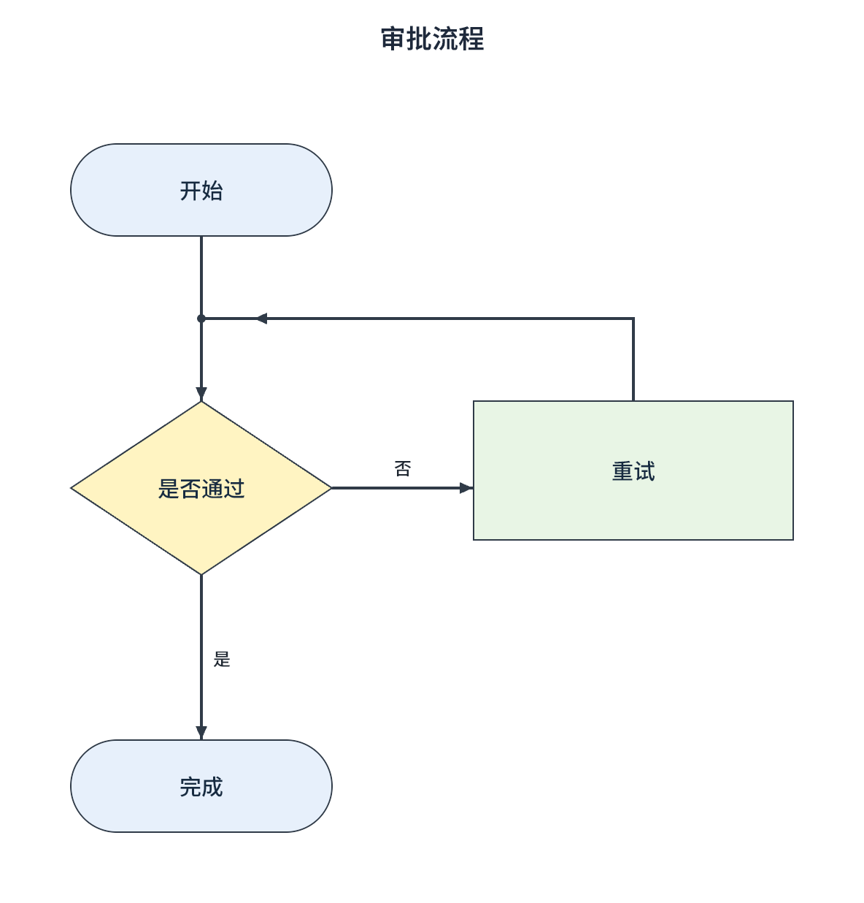

# Experimental isolated desktop snapshot renderer

For public entry points, API inventory and examples, see
[`desktop-rendering-api.md`](desktop-rendering-api.md).



`package:fflow/fflow_desktop.dart` provides `FlowIsolatedRenderService` for a
desktop host that can launch the Windows worker in `apps/hidden_render_poc`.
Each task runs in a new hidden Flutter process; a service instance queues its
tasks serially. It validates input/output byte limits, enforces a per-worker
timeout, bounds the queue to eight tasks by default, and removes its private
temporary directory after process exit. If a
timed-out worker cannot be terminated, the directory is left intact and its
path is included in the error.
The Windows runner applies a process commit limit through a Job Object before
starting Flutter; `maxWorkerMemoryBytes` defaults to 768 MiB and cannot be set
below 64 MiB. GPU allocations are not guaranteed to be covered by that Windows
limit. A worker terminated before it can write a result is reported as
`RENDER_INIT_ERROR` with its exit code and configured limit; that condition can
also have causes other than memory exhaustion.

```dart
final renderer = FlowIsolatedRenderService(executable: workerExePath);
final image = await renderer.renderSnapshot(snapshotJson, pixelRatio: 2);
// image.pngBytes, image.width, image.height, image.elapsed and image.diagnostics
```

For files, create `FlowFileRenderService` with existing, application-controlled
input and output root directories. Supply a root-relative path and an explicit
`FlowFileFormat` (`fflowJson`, `graphJson`, `mermaid`, `postgresDdl`, or `mysqlDdl`):

```dart
final files = FlowFileRenderService(
  renderer: renderer, inputRoot: inputDirectory, outputRoot: outputDirectory,
);
final result = await files.render(
  inputPath: 'examples/schema.sql', format: FlowFileFormat.postgresDdl,
  outputPath: 'schema.png', pixelRatio: 2,
);
// result.image.pngBytes, result.outputPath and result.diagnostics
```

Each render method also accepts `options: FlowRenderOptions(...)`. Options
control pixel ratio, padding, transparent background, theme, layout direction,
maximum pixel width, height and area. `theme` overrides a document theme;
`direction` overrides a diagram's layout direction. FFlow snapshots may use a
theme override but retain their existing coordinates and reject a direction
override. A Graph JSON document using `preserve` mode likewise keeps its
positions. Limits can be tightened per task but cannot exceed 8192 pixels
per side or 32 million pixels; the default output-byte limit is 64 MB. Supplying
`options` takes precedence over the legacy `pixelRatio` and `padding` arguments.
The worker process defaults to a 768 MiB Windows commit limit, configurable via
`maxWorkerMemoryBytes` on the isolated service.

`edgeRouting: FlowExportEdgeRouting.orthogonal` requests the built-in
obstacle-aware Manhattan router for non-self edges that have no explicit
control points. Existing routes and self-loops remain intact. This option is
limited to 500 nodes and 1,000 edges and considers at most 32 nearby obstacles
per edge; dense graphs can still have overlaps. The default `automatic`
preserves the adapter's built-in paths, which are orthogonal for flowcharts.
Diagnostics report routing time.

For default edge labels on graphs of at most 1,000 nodes and 2,000 edges,
export also tries nearby positions when a label overlaps a node or a previous
label, and expands the capture bounds accordingly. ER relationship labels wrap
within 320 logical pixels without a line limit and use the same placement
heuristic. This bounded search can still leave collisions or place labels away
from their edges in dense diagrams; it does not guarantee crossing-free routes.
Custom edge-label widgets are not repositioned by this heuristic.

Input reads are bounded and parsing runs in a background isolate. JSON is
checked for nesting before decoding; process requests also reject cycles,
non-JSON values, excessive nesting, values and oversized strings. Output
parents must already exist. Paths cannot be absolute, contain traversal or use
Windows device/alternate-stream names, and resolved links must remain inside
the configured roots. The output cannot be the same file as the input. On
Windows, a flushed temporary file in the destination directory is replaced via
one `MoveFileExW` call; a failed replacement keeps the previous destination.
These checks are not a defense against a hostile process changing directory
links concurrently: the configured roots and their parents must be controlled
by the host application. Other desktop filesystems have not yet been verified
for atomic replacement or integration.

Successful worker diagnostics include a task ID, input format and graph type,
input request bytes, node and edge counts, logical and pixel dimensions, PNG
bytes, worker input decoding, graph layout, rendering preparation, layout and
paint, rasterization, PNG encoding and PNG validation durations (microseconds),
plus peak process RSS where available and the configured process memory limit.
File results add original file byte count, background-isolate parsing duration
and total elapsed duration. The worker cannot currently report its graphics
backend, so that field is `unknown`; these measurements are not a GPU-memory
limit or a replacement for a deployment-specific performance assessment.

Build and distribute the whole Windows Release runner directory, including
`data` and the Flutter DLLs. The worker's built-in node appearance renders
string data or an object's string `label` property; other data falls back to
the node ID. Widget builders cannot be sent to another process. The interface
also accepts a `DiagramDocument` through `renderDiagram`; see
[`graph-json.md`](graph-json.md) for supported layout, themes and styling.
The supported Mermaid flowchart subset is described in
[`mermaid-flowchart.md`](mermaid-flowchart.md). The PostgreSQL DDL subset is
documented in [`postgresql-ddl.md`](postgresql-ddl.md), and the MySQL subset in
[`mysql-ddl.md`](mysql-ddl.md). Legends and more
advanced ER rendering remain future work.
For direct `renderMermaid`, `renderPostgresDdl`, and `renderMysqlDdl` calls, source parsing and
layout execute in the isolated worker; parsing failures are returned as
`FlowWorkerException` with a `PARSE_ERROR` code. File parsing instead runs in
a background Dart isolate before its document is sent to the worker.
It requires a normal Windows desktop session and remains an experimental PoC.

## Build and troubleshooting

From `apps/hidden_render_poc`, run `flutter build windows --release`; ship the
entire `build/windows/x64/runner/Release` directory together and configure the
host with the full path to `fflow_hidden_render_poc.exe`. Test in a logged-in
Windows desktop session. `dart run tool/worker_smoke.dart <worker.exe>
<output.png>` checks integration and creates sample images; add `100` as the
third argument for the mixed-size serial stress run. The release directory must
retain its `data` folder, including the bundled font.

For a diagnostic run that additionally samples the host isolate's memory
before and after an explicit collection every 100 tasks, use
`dart --enable-vm-service=0 run tool/worker_smoke.dart <worker.exe> <output.png> 300`.
The VM service and its instrumentation add overhead to this run; the forced
collections make its measurements unsuitable for comparison with an
unmodified production process.

`FlowWorkerException.code` is intended for programmatic handling:

| Code | What to check |
| --- | --- |
| `INPUT_NOT_FOUND`, `INPUT_READ_ERROR` | Input path, root directory and read access. |
| `INPUT_TOO_LARGE` | Input size and the documented parser and request limits. |
| `PARSE_ERROR`, `SCHEMA_ERROR`, `GRAPH_REFERENCE_ERROR` | Input syntax, schema and node, port or table references; the message contains details. |
| `IMAGE_TOO_LARGE` | Pixel ratio, padding, dimensions, pixel area and output-byte limit. |
| `RESOURCE_EXHAUSTED` | Host task queue capacity; retry when a pending task has finished. |
| `RENDER_TIMEOUT` | Worker timeout, graph complexity and desktop session availability. |
| `RENDER_INIT_ERROR` | Executable and release files, desktop session, process exit code and configured worker memory cap. |
| `PNG_ENCODE_ERROR` | Worker output integrity and available resources. |
| `OUTPUT_WRITE_ERROR` | Output root, parent directory, permissions and destination path. |

Keep `diagnostics` and the exception message for investigation. Worker task
failures expose their task ID, elapsed time and configured memory limit on
`FlowWorkerException.diagnostics`; validation failures before a worker task
starts need not have those fields. The task ID
identifies one temporary task; inputs and PNG data are not included in the
diagnostics. A worker crash cannot always distinguish memory exhaustion from
other process failures, and the reported backend is currently `unknown`.

The Windows worker bundles Noto Sans SC, loads it before measuring and
rendering text, and does not fetch fonts over the network. The font is from
Google Fonts commit `2894aab31764f10f29c421bdfd2340d3b382d384`; its SHA-256
is `a3041811a78c361b1de50f953c805e0244951c21c5bd412f7232ef0d899af0da`.
Its SIL Open Font License and copyright notice are in
`apps/hidden_render_poc/assets/fonts/OFL.txt`. The Windows-specific Chinese
export golden uses this same font; exact pixels still depend on the Flutter
SDK and Windows rendering environment. The lower-level capture API defaults to
Roboto and accepts a `fontFamily` supplied and loaded by its caller.

Per-process isolation limits the lifetime of the observed native memory growth;
it does not fix the leak in a long-lived rendering engine. The executable is a
trusted local component and its temporary directory must be located somewhere
appropriate for the snapshot data. The worker decodes each generated PNG before
returning it; the host checks the PNG signature and dimensions. Complete
rendering still depends on the worker and should be
validated on the deployment environment. `tool/worker_smoke.dart` exercises
sequential operation, error recovery, timeouts and task-file cleanup.

On Windows 10 22H2 with Flutter 3.47.7, the smoke host completed 100 additional
serial two-node snapshot tasks. Its sampled working set was 191,819,776 bytes
at task 10 and 175,153,152 bytes at task 100; the temporary task directory was
empty afterwards. That run used the build before per-task PNG decoding was
added to the worker. This covers that small snapshot and build only, not a broad
performance or memory acceptance test. Each rendering engine in this test was
short-lived, so it does not establish stability of the single-engine path.
The worker smoke also probes a 64 MiB job limit with an allocation above the
limit and a control allocation below a larger limit, then exercises all four
file formats and output replacement through the real worker.
With the 768 MiB cap and per-image decoding enabled, a later 100-task run
sampled the host at 212,918,272 bytes on task 10 and 188,424,192 bytes on
task 100; its temporary task directory was empty. The same scope limitations
apply to that run.

With the bundled font and PNG validation enabled, a subsequent 100-task run
alternated 2-node and 20-node connected snapshots. All tasks completed and
the temporary task directory was empty. Host working-set samples were
188,899,328 bytes at task 10 and 170,819,584 bytes at task 100. This is one
Windows desktop session and does not establish a bound for other graph shapes,
longer runs or graphics-driver configurations.

A later 100-task run alternating 2-node and 100-node snapshots also completed
and cleaned its temporary directory, but its host working set rose from
181,129,216 bytes at task 20 to 206,139,392 bytes at task 100, with each
10-task sample in between increasing. That observation requires a longer
follow-up and memory analysis; it does not establish the plan's sustained
stability criterion for this larger workload.

A subsequent uninstrumented 200-task run of the same alternating 2/100-node
workload completed and cleaned its task directory. Its host working set was
210,055,168 bytes at task 120, 208,990,208 at task 150 and 210,661,376 at
task 200, showing a plateau over that interval on this machine. This is one
sample run, and does not establish behavior indefinitely or for every graph.

In a separate instrumented follow-up, an explicit collection after task 100
reduced Dart isolate heap usage from 49,570,416 to 25,498,208 bytes and
reported external usage from 2,977,104 to 112 bytes. The host working set
increased while the VM service was initialized; this measurement establishes
that much of the measured isolate allocation was collectible, but does not by
itself establish long-run process-memory stability without forced collection.
That instrumented run completed 300 alternating 2/100-node tasks and cleaned
its temporary directory. Working set was 248,270,848 bytes just after the
first forced collection and 246,480,896 bytes just after the third. At task
300, isolate heap was 26,390,160 bytes before and 27,400,144 bytes after
collection, while reported external usage fell from 1,072,848 to 112 bytes.
The measurement includes VM service overhead and forced collections.

`tool/worker_benchmark.dart <worker.exe>` generates connected grid snapshots
and automatically laid-out Graph JSON at 20, 100 and 500 nodes and prints JSON
diagnostics. One Windows 10 22H2
release run before the bundled-font change at 1x produced the following observations (single sample each,
including process startup; these are not performance guarantees):

| Nodes / edges | Image pixels | Host time | Worker peak RSS |
| --- | --- | --- | --- |
| 20 / 19 | 1452 × 582 | 2.35 s | 85 MiB |
| 100 / 99 | 2352 × 1302 | 2.36 s | 120 MiB |
| 500 / 499 | 4692 × 2742 | 3.03 s | 168 MiB |

After bundling the font, a separate single run of automatically laid-out
flowcharts measured the following. The host time includes process startup;
layout is the worker's graph-layout phase. The graph structure, labels and
image size differ from the positioned snapshots above.

| Nodes / edges | Image pixels | Host time | Layout time | Worker peak RSS |
| --- | --- | --- | --- | --- |
| 20 / 15 | 536 × 432 | 2.26 s | 0.36 ms | 113 MiB |
| 100 / 90 | 1256 × 792 | 2.28 s | 2.95 ms | 130 MiB |
| 500 / 477 | 2696 × 1728 | 2.73 s | 38.55 ms | 192 MiB |

Peak RSS is the worker-reported process measurement; it does not include GPU
memory or other processes. These small samples are diagnostic observations,
not a guarantee for other graphs or machines.

After switching flowcharts to orthogonal routing by default, a repeat of the
500-node, 477-edge automatic-layout case took 2.89 seconds end to end, with
91 ms reported for layout and routing together. This single result uses the
same synthetic graph and includes process startup.
